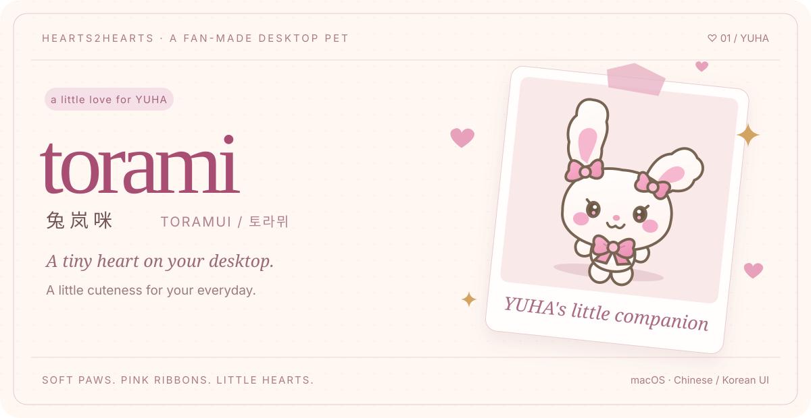
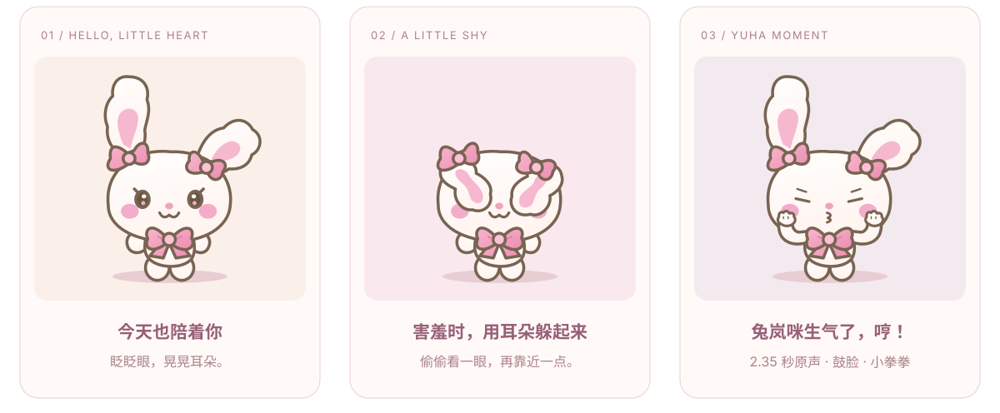
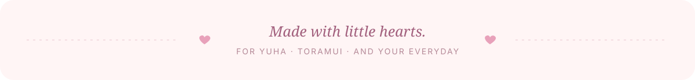

<div align="center">



# TORAMI · 兔岚咪

**A little of YUHA's charm, right at home on your Mac.**

Hearts2Hearts · YUHA · TORAMUI / 토라뮈 / 兔岚咪

**English** · [简体中文](README.zh-CN.md)

<p>
  
  
  
  
</p>

[Meet Torami](#meet-torami) · [Play together](#play) · [Get started](#start) · [Make it yours](#develop) · [Credits](#credits)

</div>

<a id="meet-torami"></a>

## 🎀 A tiny guest for your desktop

She blinks, wiggles her ears, and sits down when she needs a little rest. Give her a pat and little hearts appear; make her shy and she folds her long ears over her face. Gently place her on a window, and she'll stroll along its top edge before hopping back to your desktop.

Inspired by **YUHA and Toramui's little expressions**, this project brings “Toramui is upset, hmph!” to your desktop: tiny paws by her cheeks, a pout, a turn of the head, and a short clip of the original Korean voice.

<p align="center">
  
</p>

> **Fan-made, with love.** A desktop pet for fans of Hearts2Hearts, YUHA, and TORAMUI. The character is an editable vector fan illustration. This is an unofficial project.

<a id="play"></a>

## ♡ Spend a little time together

| What you do | What Torami does |
| :--- | :--- |
| **Click once** | Enjoys a pat and sends up hearts; wakes up if she's asleep. |
| **Double-click** | Waves happily and does a little hop. |
| **Pick up and release** | Dangles, falls, and bounces gently on landing. A quick drag lets you toss her. |
| **Make her shy** | Folds her long ears over her eyes, then sneaks a peek. |
| **“Hmph!”** | Plays **2.35 seconds of YUHA's original Korean voice** with a pout, cheek-side paws, and a head turn. Sound can be turned off. |
| **Place her on a window** | Settles on an exposed top edge, walks to the edge, then hops down. Moves along with the window. |
| **Let her roam / follow the cursor** | Walks around, sits, sways, or follows the cursor's horizontal position. |
| **Invite another Torami** | Keeps up to five independently interactive pets on your desktop. |

### Thoughtful little comforts

- **Steps aside for fullscreen:** hides during macOS green-button fullscreen and video fullscreen, then returns afterward. Supports notched displays.
- **Chinese / Korean app interface:** menus, bubbles, statistics, and hints switch between **中文 / 한국어** without interrupting an action. English is the default documentation language; the app UI currently supports Chinese and Korean.
- **Transparent and always on top:** drag her around; transparent areas pass mouse input through. Full click-through mode is also available.
- **Remembers your preferences:** saves language, size, sound, roaming, fullscreen hiding, and the first pet's position and sleep state.
- **Stays local:** runs offline, does not read window titles or contents, and does not request screen-recording, camera, or microphone access.

<details>
<summary><b>🎛 Right-click menu and shortcuts</b></summary>

The right-click menu has seven top-level entries: **Interact, Companion, Pause, Sound, Settings, Language, and Quit**. The table below includes the labels shown in the Chinese UI.

| What you're looking for | Menu entry |
| :--- | :--- |
| Pat / shy / hmph / happy hop | Interact · 互动 |
| Roam / follow / sit / sway / sleep | Companion · 陪伴方式 |
| Size / automatic roaming / hide in fullscreen | Settings · 设置 |
| Multiple pets / statistics / click-through / hide / reset position | Settings · 设置 |
| Chinese / Korean | Language · 语言 / 언어 |

**`⌘ ⇧ T`** hides or brings back all pets and restores interaction when click-through is enabled. It does not force pets to appear over fullscreen windows.

The little rabbit in the menu bar can also bring her back. Removing the last pet leaves the app in the menu bar, ready to summon another.

</details>

<details>
<summary><b>🪟 Window perching and a gentle nudge</b></summary>

Bring Torami's feet close to an **exposed top edge of another app's window**, then release. There must be enough space above the window for her whole body, so maximized windows usually aren't suitable.

She walks to the edge before hopping down, even when automatic desktop roaming is off. Choose sitting or sleeping to keep her perched; return to free roaming to continue her stroll. If the window disappears or its supporting edge is covered, she falls.

**Settings → Window interaction → Gently push window** (设置 → 窗口互动 → 轻轻推窗口) nudges her supporting window sideways by about 120 points. The restore action tries to put nudged windows back; the app also attempts to restore them on exit.

Nudging a window requires macOS **Accessibility** permission, requested only when you choose that action. Other interactions work without it.

</details>

<a id="start"></a>

## 🍓 Bring Torami home

Current target: **Apple Silicon Macs running macOS 13 or later**.

### Run from source

Install Node.js, npm, and Xcode Command Line Tools, then run:

```bash
git clone https://github.com/yigechen07/torami.git
cd torami
npm ci
npm start
```

The first launch generates the character page and icons, and compiles the small native helper that reads macOS window geometry.

### Build the app

```bash
npm run package
```

Open `release/mac-arm64/兔岚咪.app` when the build finishes. Use `npm run dist` to create a DMG.

This fan prototype is not signed or notarized by Apple. The repository contains source code; build outputs are excluded from Git.

<a id="develop"></a>

## 🧵 Stitch in a little something new

Torami uses **Electron + layered SVG + CSS animations**, with a small Swift helper for window geometry. There is no Live2D model dependency: the character and motions can be edited directly.

```text
torami/
├── src/pet/                 # Character, motions, bubbles, and UI translations
│   ├── torami.svg           # Editable layered vector character
│   ├── pet.css              # Breathing, walking, shy, and hmph animations
│   ├── performance.js       # Voice and expression timing
│   └── i18n.js              # Chinese / Korean app interface
├── src/pet-controller.cjs   # Dragging, reactions, perching, and pet behavior
├── src/fullscreen.cjs       # Fullscreen detection, including notched displays
├── src/popup-menu.cjs       # Native menus and submenu placement
├── native/                 # macOS window geometry and explicit nudging
├── scripts/                # Page, icon, and README artwork generation
└── test/                   # Physics, surfaces, preferences, and fullscreen checks
```

| Command | Purpose |
| :--- | :--- |
| `npm test` | Checks physics, exposed surfaces, landing, preferences, UI translations, and fullscreen detection. |
| `npm run check` | Checks JavaScript syntax. |
| `npm run smoke` | Launches Electron to check voice playback, menus, multiple pets, window walking, and system / video fullscreen. |
| `npm run icons` | Regenerates the character page, icons, and native helper. |
| `node scripts/build-readme-art.cjs` | Regenerates English and Chinese README artwork from the same character SVG. |

The smoke check uses separate temporary preferences and muted audio, preserving your everyday position. The standalone AppKit fixture in `test/fixtures/fullscreen.swift` covers green-button fullscreen and elevated video-style fullscreen windows.

To add an expression, start with the character layers and `pet.css`. To change interactions, look at `pet-controller.cjs`. The [reference feature mapping](docs/reference-features.md) records implementation details and platform differences in Chinese.

<details>
<summary><b>💌 A few little questions</b></summary>

**Where did Torami go?** Leave fullscreen first, then use the menu-bar rabbit or `⌘ ⇧ T`. You can also reset her position in Settings.

**Why won't she stay on a window?** Enable window interaction, make sure the top edge is exposed, and leave enough room above it for her whole body.

**How do I mute the voice?** Turn off Sound in the right-click menu; the animation still plays. Pause stops movement, animation, and audio together.

**What about Windows or Intel Macs?** Current builds and native window interactions target Apple Silicon Macs. Other platforms have not been verified.

**Where are preferences stored?** Locally at `~/Library/Application Support/兔岚咪/settings.json`.

</details>

<a id="credits"></a>

## ♡ Inspiration, assets, and thanks

This little project takes its heart from **Hearts2Hearts' YUHA and TORAMUI**, and its interaction inspiration from the desktop-pet community.

- **Character:** a manually drawn vector fan prototype, not official artwork or original animation frames.
- **YUHA's voice:** a 2.35-second excerpt from [삐진 토라뮈 모음집](https://www.youtube.com/shorts/nwy38Jg5PHQ), in the original Korean, with no synthesized or cloned voice. See the [source and processing notes](src/assets/audio/README.md).
- **Implementation references:** [AHaldner/desktop-pet](https://github.com/AHaldner/desktop-pet) and [IvenKooLab/desktop-pet](https://github.com/IvenKooLab/desktop-pet).
- **Window interaction reference:** [凉凉最爱4536's desktop-pet video](https://www.douyin.com/video/7699216927968808243). The behaviors were independently implemented; the creator's sprite frames and program are not bundled.

Original code is available under the [MIT License](LICENSE). **Character designs, names, trademarks, and third-party recordings are outside that license** and remain the property of their respective rights holders. See [THIRD_PARTY_NOTICES.md](THIRD_PARTY_NOTICES.md) for details.

<p align="center">
  
</p>
